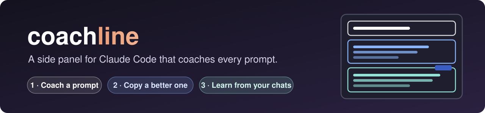
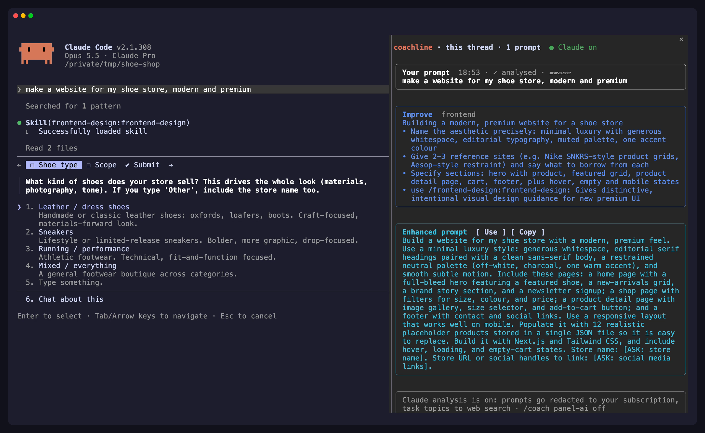
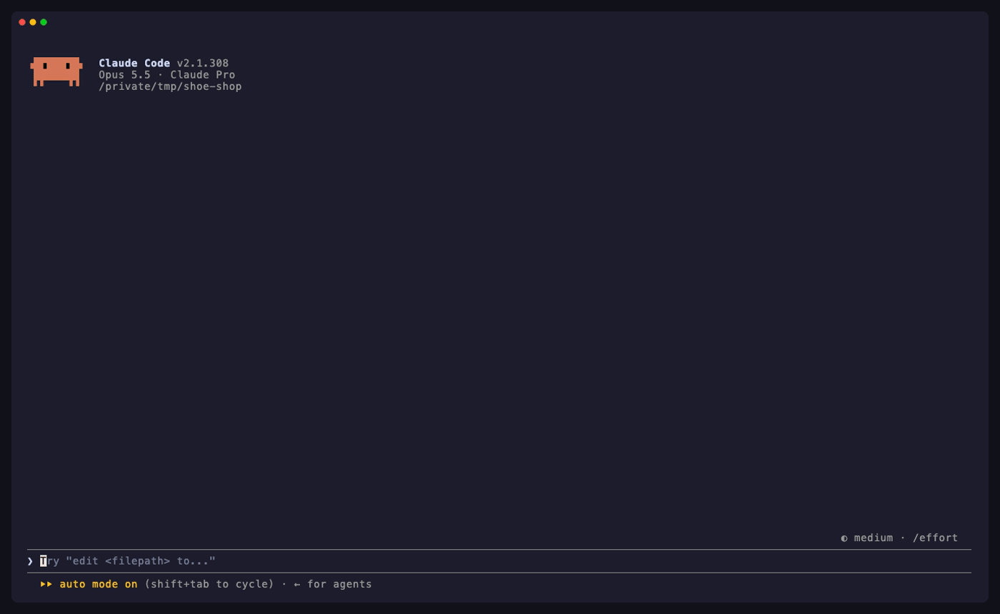
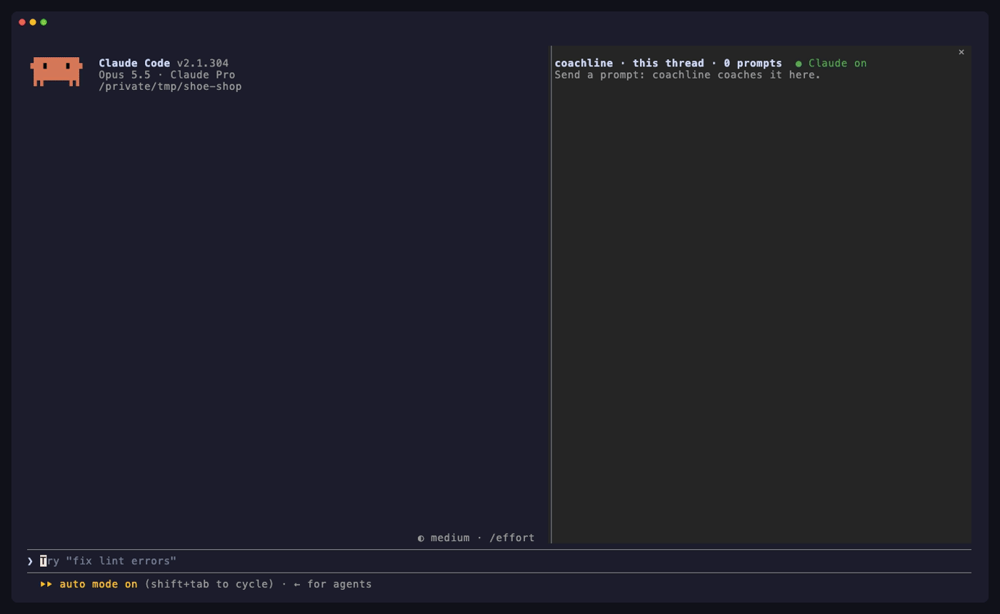
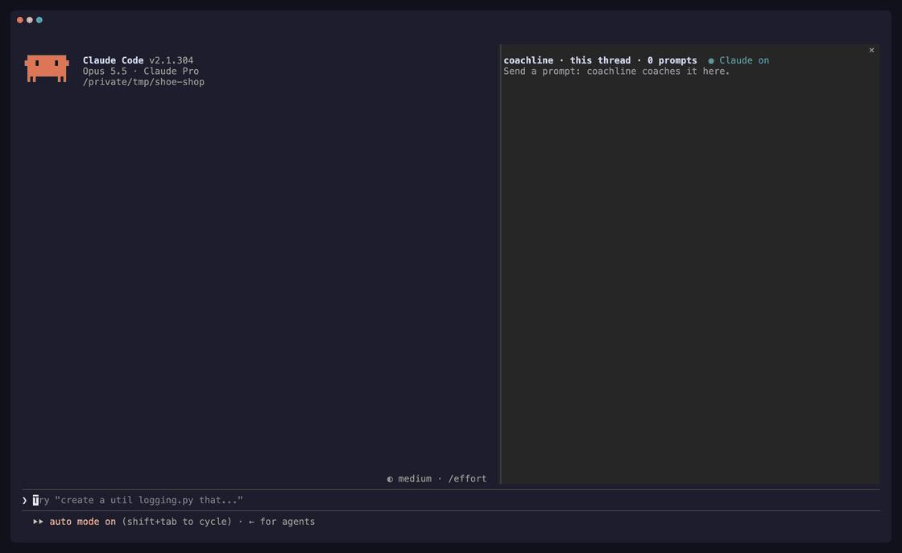
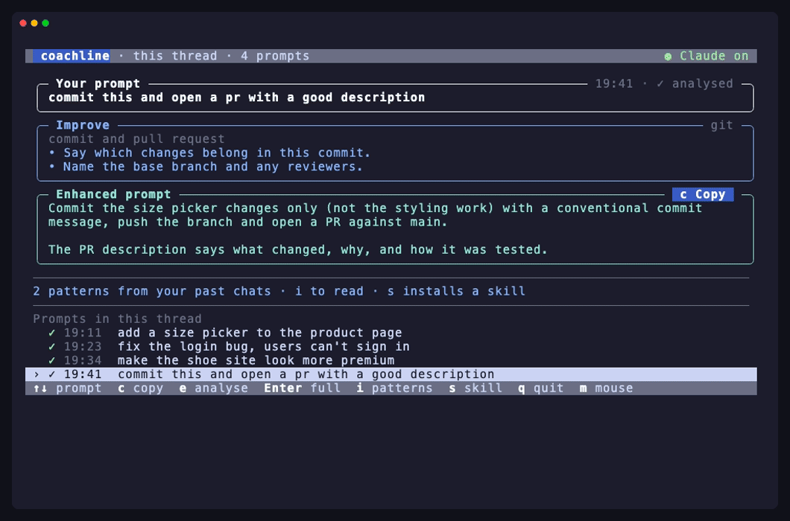
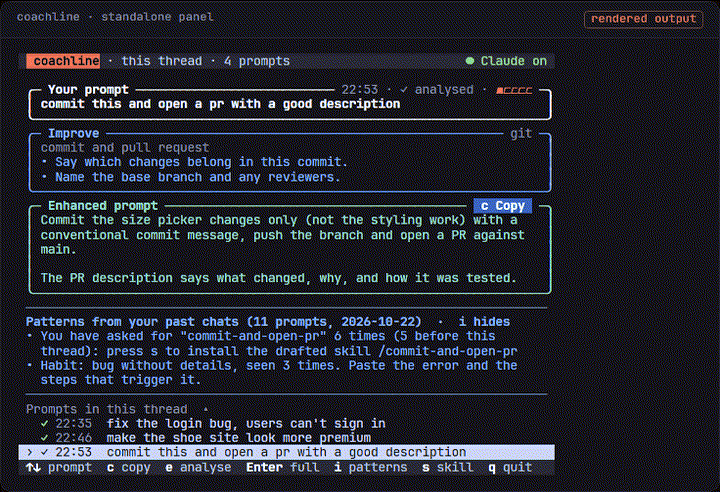
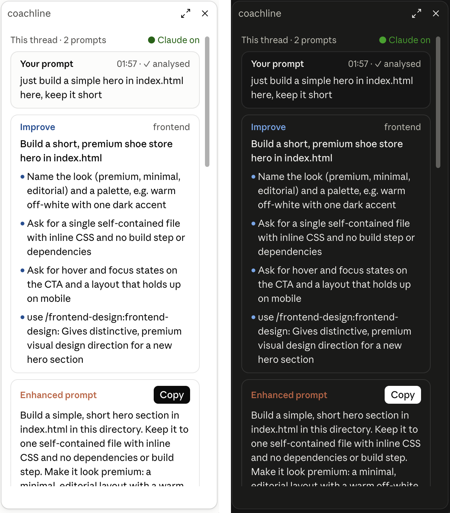
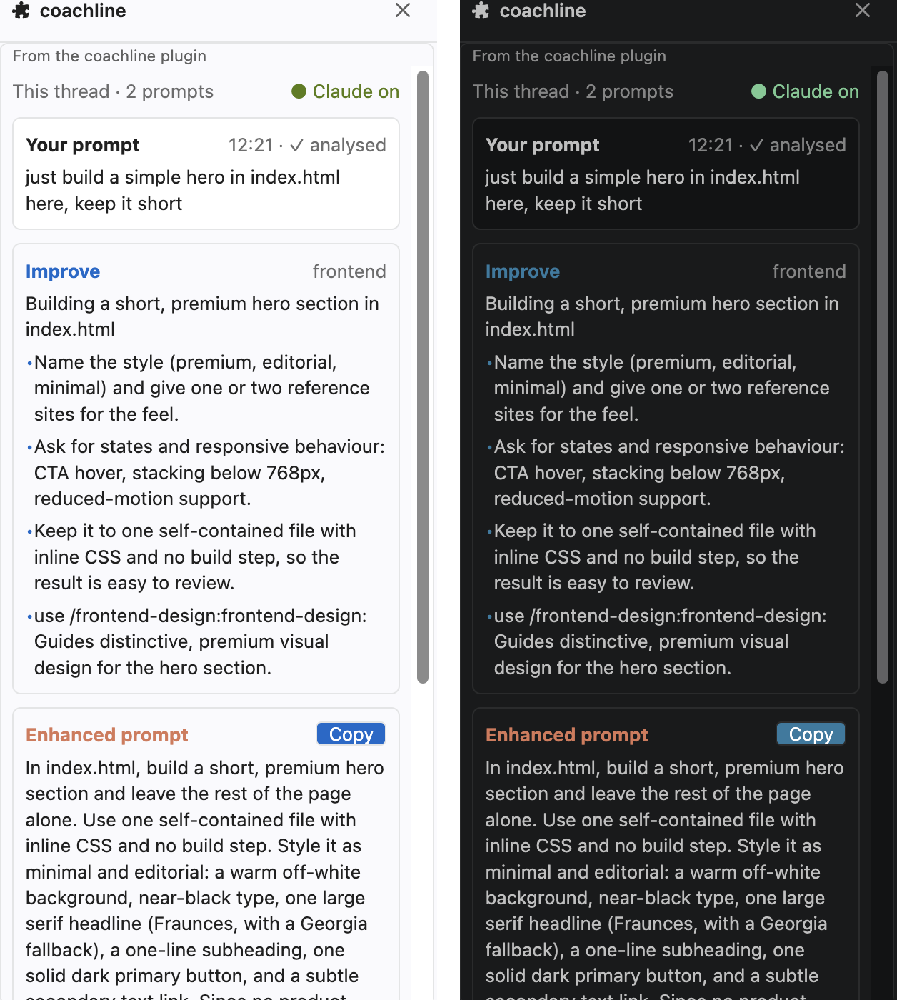

<p align="center">
  
</p>

<p align="center">
  <a href="https://github.com/teransarathchandra/coachline/releases"></a>
  <a href="https://github.com/teransarathchandra/coachline/actions/workflows/ci.yml"></a>
  
  
  
  <a href="LICENSE"></a>
</p>

<p align="center">
  coachline sits next to <b>Claude Code</b>, shows the prompts of your conversation, says how each one could be better<br>
  and hands you an enhanced version to copy. Claude does the analysis on <b>your own subscription</b>.
</p>

<p align="center">
  <a href="#install"></a>
  <a href="#install"></a>
  <a href="#windows"></a>
  <a href="#desktop"></a>
  <a href="#editors"></a>
</p>



## How it works

### 1 · Install, and the panel opens beside Claude Code

Two commands in Claude Code, and coachline opens in a side panel right away. No restart, no API key.



### 2 · Type a prompt, see how to make it better

Work as usual. While Claude works on your prompt, the panel shows what to **improve** and an **enhanced prompt**, with `[ASK: …]` where only you know the answer. **Use** puts it in your prompt box; while you type, the line under the box says what your draft lacks, or that a prompt like it worked before. Those land in your **Library**.



### 3 · Starting something new? Get the skills, tools and references for it

For a new task, coachline names the **skills and plugins** you have that fit, then searches the web for **tools, docs and reference sites**, and checks each link before you see it.



<details>
<summary><b>More:</b> browse the whole thread, and patterns from your past chats</summary>

<br>`↑` `↓` move through the conversation. Each prompt keeps its card, with links Claude found on the web and **checked on your machine** first.



`i` shows the habits and repeated requests Claude spotted in your history. `s` turns a repeated request into a skill.



</details>

## Install

You need [Claude Code](https://claude.com/claude-code) (signed in, `claude` works in your terminal) and **Python 3.9+**. In Claude Code:

```
/plugin marketplace add teransarathchandra/coachline
/plugin install coachline@coachline
```

coachline is active straight away.

<details open>
<summary> <b>macOS</b> ·  <b>Linux</b>: nothing else to do</summary>

<br>The panel opens inside Claude Code, beside the conversation: as soon as it is installed, then at the start of every session (from 144 columns wide; narrower, with your first prompt). Needs Claude Code 2.1.287 or newer; with an older one, use `/coach watch` as described under *any terminal* below.

</details>

<details open id="desktop">
<summary> <b>Claude desktop app</b> (macOS · Windows): nothing else to do</summary>

<br>In a Code session, the pane opens on the right with your first prompt, in the app's own look, light or dark. The app's Code sessions use the plugins you installed in Claude Code.



</details>

<details id="windows">
<summary> <b>Windows</b>: one command</summary>

<br>In the terminal, run this once in Claude Code. From then on every session opens the panel in a Windows Terminal split, one panel per tab (the desktop app has its own pane):

```
/coach auto-open on
```

</details>

<details open id="editors">
<summary> <b>VS Code</b> · <b>Cursor</b> · <b>Windsurf</b> · <b>Antigravity</b>: nothing else to do</summary>

<br>With the Claude Code extension, the pane opens beside the Claude Code tab, in your editor's theme, light or dark. The extension uses the plugins you installed in Claude Code.



</details>

<details>
<summary> <b>JetBrains</b> · any terminal</summary>

<br>Run `/coach watch` in Claude Code. It prints a one-line command: paste it into a split terminal next to Claude Code.

</details>

**Check your setup:** `/coach doctor` checks Python, the `claude` CLI and your history; `/coach setup` shows your settings.

## Keys

| | | | |
|---|---|---|---|
| `↑` `↓` | choose a prompt | `c` | copy the enhanced prompt |
| `Enter` | read it full width | `e` | analyse it now |
| `i` | patterns from past chats | `s` | install a drafted skill |
| `m` | mouse on or off | `q` | quit |

In the Claude Code pane, the desktop app and the editors, click its buttons (`[ Copy ]`, `[ Analyse ]`); the keys are for the standalone panel (Windows and `/coach watch`). Every key, mark and `/coach` command: [usage guide](docs/usage.md).

## Private by design

- 🔑 **No API key.** Claude runs through your own Claude Code login, and there's no telemetry.
- 🧹 **Redacted first.** Emails, keys and tokens are removed and pasted text is never sent. List a project in `~/.claude/coach/llm-off.txt` to keep it out entirely.
- ✅ **Checked on your machine.** Counts are recomputed, skill names must exist, and every link must load before you see it.
- 🔌 **Off in one command.** `/coach panel-ai off` keeps only the built-in local hints.

What is sent and when: [privacy](docs/privacy.md).

## Documentation

[Usage](docs/usage.md) · [Privacy and accuracy](docs/privacy.md) · [Troubleshooting](docs/troubleshooting.md) · [Changelog](CHANGELOG.md)

## Contributing

Issues and pull requests are welcome: see [CONTRIBUTING.md](CONTRIBUTING.md). Security reports go through [SECURITY.md](SECURITY.md).

[MIT](LICENSE) © Teran Sarathchandra
